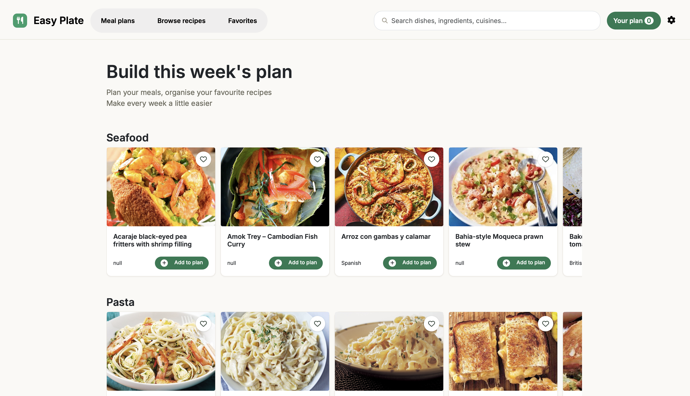
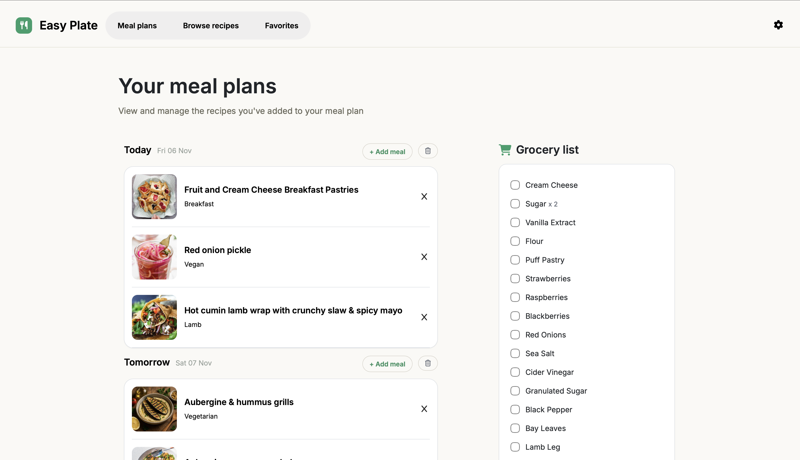
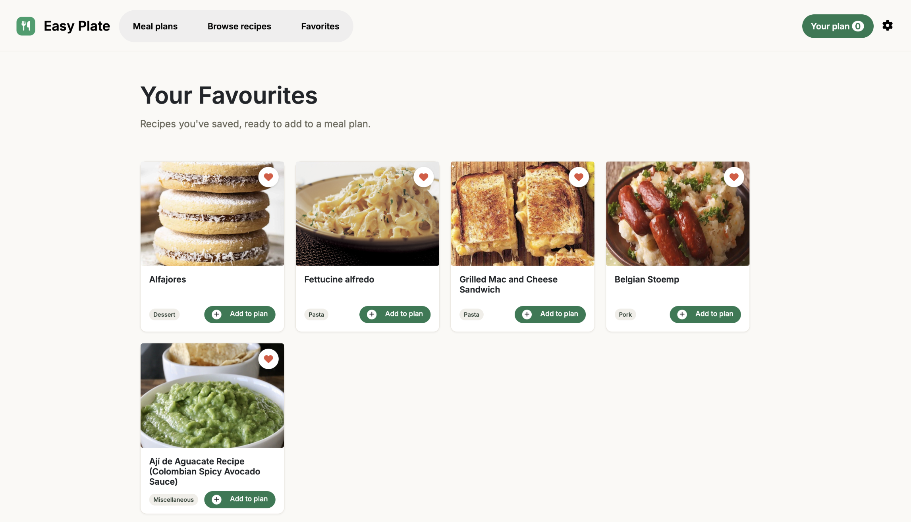

# EasyPlate 🍽️

A full-stack meal planning application built with Ruby on Rails. Discover recipes, save favourites, organise meals by date and get automatically generated grocery lists.

**Live Demo:** [EasyPlate](https://easy-plate-eu-65218bb12f71.herokuapp.com)

---

## Screenshots

### Recipe Discovery

### Meal Planning

### Saved Recipes

---

## Features

- Discover and search recipes from the TheMealDB API
- Save and manage favourite recipes
- Create meal plans with date-based scheduling
- Generate grocery lists automatically from meal plans
- User authentication and account management with Devise
- Persistent UI state using Stimulus and browser storage
- Responsive design built with Bootstrap

---

## Tech Stack

### Backend

- Ruby on Rails
- SQLite (development)
- PostgreSQL (production)

### Frontend

- JavaScript
- Stimulus
- Turbo
- Bootstrap

### Authentication

- Devise

### API

- TheMealDB

### Deployment

- Heroku

---

## What I Learned

Building EasyPlate gave me practical experience developing and maintaining a full-stack web application from idea to deployment.

During development I:

- Modelled relational data for users, recipes, meal plans and grocery lists
- Consumed and displayed data from a third-party API
- Built dynamic interfaces using Stimulus and Turbo
- Managed application state across Rails sessions and browser storage
- Diagnosed and fixed data consistency issues involving API identifiers, sessions and database relationships
- Worked with foreign key constraints and Rails associations to maintain data integrity
- Debugged production deployment issues and configured PostgreSQL on Heroku
- Deployed and maintained a production Rails application

---

## Future Improvements

- Edit existing meal plans
- Advanced recipe filtering and search
- Drag-and-drop meal scheduling

---

## Author

**Philip Samuel Ringdal**
